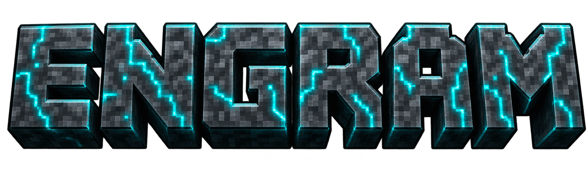

<div align="center">



### Long-term memory for AI agents, in one Rust binary.

**No MCP server. No cloud store. Just shell out.**

[](https://github.com/paperfoot/engram-cli/stargazers)
[](https://x.com/longevityboris)
[](https://crates.io/crates/paperfoot-engram)
[](https://github.com/paperfoot/homebrew-tap)
[](LICENSE)

[Install](#install) · [How agents use it](#how-agents-use-it) · [Benchmarks](#benchmarks) · [Guide](docs/guide.md) · [All benchmarks](docs/benchmarks.md)

</div>

---

Your agent forgets everything when the session ends. engram gives it a memory that lasts: people, decisions, preferences, health facts and dated events, plus the papers and docs it should answer from. It keeps facts current when they change, refuses to quietly overwrite the ones that matter, and cites a source for every answer.

```bash
engram remember "Sarah prefers async standups; sync only for incidents." --kb personal
engram remember "Dad takes metformin 500 mg twice a day." --kb personal
engram recall "how does Sarah like to run standups"
engram state "Dad"          # what is true now: open facts, grouped, with sources
```

## Why engram

| | |
|---|---|
| **Memory that updates itself** | A new fact replaces the old one for the same slot ("works at Acme" → "works at Globex"). The old value stays in the history, and `recall` tells the agent it changed. |
| **Safety facts are never overwritten** | Medications, allergies and diagnoses can each hold several values. A real conflict goes back to the agent to decide; engram never resolves it silently. |
| **Knows when, not just what** | Facts carry validity intervals and event times, so "what was true last March?" has an answer. |
| **Cites or abstains** | Every result carries its source. On LitQA2 it gave **0 wrong answers** on the questions it could not find evidence for. |
| **Fast, local, one file** | A single SQLite database on your machine. Dense + keyword search fused, then reranked. No server, no Docker, no Python. |
| **Built for agents** | One `agent-info` call teaches an agent every command. JSON on stdout, errors on stderr, meaningful exit codes, no prompts. |

**No MCP server. No cloud store. Just shell out.** Your agent calls `engram` the way it already calls `git`, `gh` and `jq`. There is no tool schema to load on every session and no daemon to keep alive (a local HTTP API is there when you want one).

## Install

```bash
brew install paperfoot/tap/engram         # macOS / Linux
# or
cargo install paperfoot-engram --locked   # anywhere with Rust 1.88+

engram config set keys.gemini $GEMINI_API_KEY   # embeddings (free tier works)
engram skill install                            # teaches Claude Code, Codex and Gemini CLI to use it
```

Optional: `keys.cohere` adds reranking and `keys.openrouter` adds automatic fact extraction. `engram config check` validates the keys you set. For a keyless trial, `--offline` uses a local stub embedder: fine for testing, not for real recall.

## How agents use it

The installed skill teaches a three-step loop:

```bash
# 1. Recall before answering. Reads span every knowledge base by default.
engram recall "user's task in a few words" --top-k 5 --json

# 2. Do the work, citing what came back.

# 3. Save what will matter later: preferences, decisions with reasons, corrections.
engram remember "Chose SQLite over Qdrant: one-file deploy beat index features." \
  --kb business --tag decision --importance 9
```

Agents can also hand engram the facts they already know. `--facts-json` stores them with full conflict checking and no model call.

## What you can build

| Memory | What goes in | Ask it |
|---|---|---|
| **Personal** | People, family, preferences, health notes, birthdays | `engram people show "Sarah"` · `engram state "Dad"` |
| **Business** | Decisions and their reasons, market intel, deals | `engram recall "why did we pick SQLite" --kb business` |
| **Research** | PDFs and papers, chunked by section | `engram recall "rapamycin dosing in humans" --kb ageing --mode evidence` |
| **Docs and code** | API docs, release notes, architecture decisions | `engram recall "SwiftUI navigation migration" --kb swiftui` |
| **Support** | Help-centre articles, policies, resolved tickets | `engram recall "refund policy for annual plans" --kb support` |

## Benchmarks

| Benchmark | What it tests | engram |
|---|---|---|
| **LongMemEval S** (500 questions, 96% distractors) | Finding the right memory | **R@5 0.990**, R@10 0.998 |
| **LitQA2** (199 biomedical questions) | Answering from a domain corpus | **87.9%** accuracy vs 43.7% without retrieval; 0 wrong answers on retrieval misses |
| **BEIR SciFact** (300 queries, 5,183 docs) | Scientific retrieval ranking | **nDCG@10 0.817** vs ~0.74 for a strong dense retriever |

Every run logs per-question results, token counts and model IDs to [`benchmarks/`](benchmarks/). Methods, caveats and the commands to reproduce each number are in [docs/benchmarks.md](docs/benchmarks.md).

## How it works

```
 query ─┬─ dense (Gemini Embedding 2) ─┐
        ├─ keyword (SQLite FTS5)       ├─ rank fusion ─ rerank ─ per-source cap ─ JSON
        └─ facts, entities, graph     ─┘
```

- **SQLite is the source of truth.** Vectors, full-text index, facts and an append-only journal live in one file.
- **Facts are intervals.** Corrections close a fact rather than delete it, so history stays queryable and `admin rebuild` can replay it.
- **Deterministic.** Stable IDs, stable ranking ties, reproducible benchmark runs.

The full reference (configuration, knowledge bases, the papers workflow, every command, the local API) is in **[docs/guide.md](docs/guide.md)**.

## Contributing

Issues and pull requests are welcome. `cargo test` runs offline against temporary stores and never touches yours.

---

<div align="center">

**No MCP server. No cloud store. Just shell out.**

If engram saves your agent from forgetting, give it a star. It helps other people find it.

[](https://github.com/paperfoot/engram-cli/stargazers)
[](https://x.com/longevityboris)

Built by [Boris Djordjevic](https://github.com/longevityboris) at [Paperfoot AI](https://paperfoot.com) · [borisdjordjevic.com](https://borisdjordjevic.com)

MIT licence · Follows the [agent-cli-framework](https://github.com/paperfoot/agent-cli-framework)

</div>
